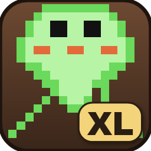

# SpriteEditXL

<p align="center">
  
</p>

A cross-platform Atari Player/Missile sprite editor, written in C# / Avalonia.

SpriteEditXL is a desktop port and extension of bocianu's JavaScript
[SprEd](https://gitlab.com/bocianu/spred). It keeps full compatibility with the
original `.spr` binary format and the community library at restdb.io, and adds
a native desktop workflow — animation sub-sequences, reference image overlay,
drag-and-drop, local library — while staying faithful to SprEd's chunky brown
toolbar and gold selection highlights.

## Features

- All original SprEd sprite modes: P0, P0+P1, MP0+MP1, through MP0+MP1+MP2+MP3
- Per-row DLI color changes
- Common palette, link colors, frame delay, multi-frame edit
- Animation playback with named sub-sequences and drag-to-reorder frames
- Reference image overlay (any PNG/GIF/JPG) with minimap and scale controls
- Three-tab community library:
  - **SpriteEditXL** — read + write (upload your sprites)
  - **SprEd (read)** — read-only mirror of bocianu's original library
  - **Local** — sprites saved under `%APPDATA%/SpriteEditXL/library/`
- Sort by date / name / frame count × ascending / descending
- 24-hour on-disk cache for library pages
- Animated GIF export and atasm source export
- Drag-and-drop `.sprj` / `.spr` / `.apl` onto the window to open
- Per-frame delay editing (click the orange number)
- Undo / Redo with configurable depth

## Install

Grab a prebuilt binary from the [latest release](https://github.com/CycoPH/SpriteEditXL/releases/latest):

| Platform  | File                            |
|-----------|---------------------------------|
| Windows   | `SpriteEditXL-win-x64.zip`      |
| Linux     | `SpriteEditXL-linux-x64.tar.gz` |
| macOS Intel      | `SpriteEditXL-osx-x64.tar.gz`   |
| macOS Apple Silicon | `SpriteEditXL-osx-arm64.tar.gz` |

Each archive contains a single self-contained executable — no .NET runtime
required.

### macOS note

On first launch, macOS Gatekeeper may block the unsigned binary. Allow it with:

```bash
xattr -d com.apple.quarantine SpriteEditXL
```

Or right-click the app → **Open** → **Open anyway**.

## Build from source

Requirements: [.NET 11 SDK](https://dotnet.microsoft.com/download).

```bash
git clone https://github.com/CycoPH/SpriteEditXL.git
cd SpriteEditXL
dotnet run
```

### Release build (single-file, self-contained)

```bash
dotnet publish -c Release -r win-x64 -o publish/win-x64      # Windows
dotnet publish -c Release -r linux-x64 -o publish/linux-x64  # Linux
dotnet publish -c Release -r osx-x64 -o publish/osx-x64      # macOS Intel
dotnet publish -c Release -r osx-arm64 -o publish/osx-arm64  # macOS ARM
```

The output is a single ~48 MB executable with no external dependencies.

## How to use

### The 60-second tour

1. **Pick a template** — *Options…* → *Sprite template* has presets (single P0, P0+P1 wide, MP0+MP1 double-line, aNode 10×20, etc.).
2. **Click a color** on the left strip (`C0`/`C1`/`C2`/`C3`) or press `1`–`6`, then paint on the big editor. Right-click or `Shift+Left-click` paints the background color.
3. **Add frames** with `Insert`, step through with `←`/`→`, hit `Space` to play.
4. **Make sub-sequences** — the *Primary* strip under the editor holds all frames. Click **➕** below it to add a new named sequence and drag frames from Primary into it.
5. **Export** with `Ctrl+E` for assembly source, or *File → Export animated GIF*.

### Mouse — editor canvas

| Action                          | What it does                                                       |
|---------------------------------|--------------------------------------------------------------------|
| **Left click / drag**           | Paint with the currently selected color                            |
| **Right click / drag**          | Paint with the background color (erase)                            |
| **Shift + Left click**          | Also paints background (useful on tablets without a right button)  |
| **Mouse wheel**                 | Zoom in / out (or use `+` / `−`)                                   |
| **Hold `Alt`, hover a row**     | Shows the row gutter — click the green `+` to insert a row, red `−` to delete |

### Mouse — color strip (left panel)

| Action                                       | What it does                                              |
|----------------------------------------------|-----------------------------------------------------------|
| **Left click** a color slot                  | Make it the active paint color                            |
| **Double click** a color slot                | Open the Atari palette picker                             |
| **Left click** the rainbow swatch in a slot  | Open the palette picker directly                          |
| **Right click** a color slot                 | Toggle that player/missile's visibility (shows ×)         |
| **Click** the gold chain glyph between pairs | Toggle *Link colors* (paint mirrors C0↔C2, C1↔C3)         |

### Mouse — frame strip (Primary and sub-sequences)

| Action                                          | What it does                                                           |
|-------------------------------------------------|------------------------------------------------------------------------|
| **Left click** a frame                          | Make it the active frame                                               |
| **Shift + Left click** a frame                  | Set the movie loop range from current → clicked. Playback and transforms honor it. |
| **Click** the orange delay number below a frame | Edit delay for that frame (prompts with movie-loop range-apply option) |
| **Press & drag** a frame                        | Reorder within Primary, or copy into another sub-sequence              |
| **Mouse wheel over a strip**                    | **Step through its frames one at a time — a quick way to flip-book any sequence without hitting Play.** Handles repeated indices (ping-pong loops like `17,18,19,20,19,18,17`). |

### Mouse — DLI panel (right side, when DLI mode is on)

| Action                                   | What it does                                                           |
|------------------------------------------|------------------------------------------------------------------------|
| **Left click** a row                     | Select that scanline for DLI color editing                             |
| **Shift + Left click** a row             | Select a range of scanlines. Subsequent palette edits apply to the range. |
| **Double click** a swatch                | Open the palette picker for that scanline + color slot                 |

### Mouse — reference image minimap

| Action                      | What it does                                                        |
|-----------------------------|---------------------------------------------------------------------|
| **Left-drag inside minimap**| Pan the source rectangle — the editor shows that region of your reference image. |

### Keyboard — files & edit

| Shortcut       | Action                            |
|----------------|-----------------------------------|
| `Ctrl+N`       | New sprite                        |
| `Ctrl+O`       | Open .sprj / .spr / .apl          |
| `Ctrl+S`       | Save as .sprj                     |
| `Ctrl+E`       | Export source code dialog         |
| `Ctrl+Z`       | Undo                              |
| `Ctrl+Y`       | Redo                              |
| `Ctrl+C`       | Copy current frame                |
| `Ctrl+V`       | Paste frame                       |
| **Drag & drop**| Drop a `.sprj` / `.spr` / `.apl` onto the window to open |
| `F1`           | Keyboard shortcuts dialog         |

### Keyboard — frames & playback

| Shortcut      | Action                                 |
|---------------|----------------------------------------|
| `Space`       | Play / stop the active sequence        |
| `←` / `→`     | Previous / next frame                  |
| `Home` / `End`| First / last frame                     |
| `Insert`      | Add a new blank frame after the current one |
| `Delete`      | Delete current frame                   |
| `↑` / `↓`     | *(DLI mode only)* Previous / next scanline |

### Keyboard — colors & palette

| Shortcut   | Action                                        |
|------------|-----------------------------------------------|
| `0` or `~` | Select background color                       |
| `1`        | Select **C0**                                 |
| `2`        | Select **C1**                                 |
| `3`        | Select **C0 OR C1**                           |
| `4`        | Select **C2**                                 |
| `5`        | Select **C3**                                 |
| `6`        | Select **C2 OR C3**                           |
| `[`        | Copy color palette from current frame         |
| `]`        | Paste color palette to current frame          |
| `Shift+[`  | Copy DLI color table                          |
| `Shift+]`  | Paste DLI color table                         |

### Keyboard — view toggles

| Shortcut   | Action                                         |
|------------|------------------------------------------------|
| `+` / `−`  | Zoom in / out (also mouse wheel over editor)   |
| `W`        | Toggle *wrap editor* (so sprite edges meet)    |
| `G`        | Toggle grid overlay                            |
| `M`        | Toggle *mark active region* (yellow box around active sprite's columns) |
| `O`        | Toggle *OR draws outside* (how merged color spills beyond the gap) |
| `Alt` *(hold)* | Show the row gutter on the editor's left edge |

### Quick tips

- **Flip-book any sequence instantly:** hover over its frame strip and spin the mouse wheel. No need to hit Play.
- **Apply a change to a run of frames:** Shift-click two frames to make a movie loop, then draw / transform / edit delay — they all honor the loop.
- **Hover the palette picker:** the bottom of the picker shows a *current → hover* color comparison with hex values, so you can audition colors before clicking.
- **Reference image too big?** Drop it in, then drag inside the minimap thumbnail (top-right area) to pan around. Use the `X` / `Y` zoom spinners next to the reference controls to match your sprite's pixel aspect.
- **Delay editing with range apply:** click an orange delay number on a frame; if that frame is inside a movie loop, you'll be asked whether to apply the new delay to the whole loop.

## File formats

- `.sprj` — primary format (JSON, human-readable, versioned)
- `.spr`  — legacy binary format, compatible with the original SprEd. Opening a
  `.spr` automatically writes a `.sprj` sibling for future opens.
- `.apl`  — alternate legacy variant (auto-detected)

## Credits

- Original JavaScript SprEd: **bocianu** — <https://gitlab.com/bocianu/spred>
- C# / Avalonia port: Peter Hinrichsen (readyplaygaming)

## License

MIT — see [LICENSE](LICENSE).
